# Jarvis Net Tools

**A pocket network lab on a Raspberry Pi.** Plug it in at any site, join the Wi-Fi from the touch screen or a phone, and
see what the network is really doing: Wi-Fi channels and access points, devices on the LAN, live ping / route / port scans,
DNS and DHCP checks, an Ethernet jack tester, a speedometer-style speed test with a bufferbloat grade, and a built-in
AI assistant that explains what is wrong and where to look.

> **Preview only.** This page shows what Jarvis Net Tools is and what it does. The source code is private and not
> published here. Interested in using it or working together? Ask first via the GitHub profile **X4Applegate**.

  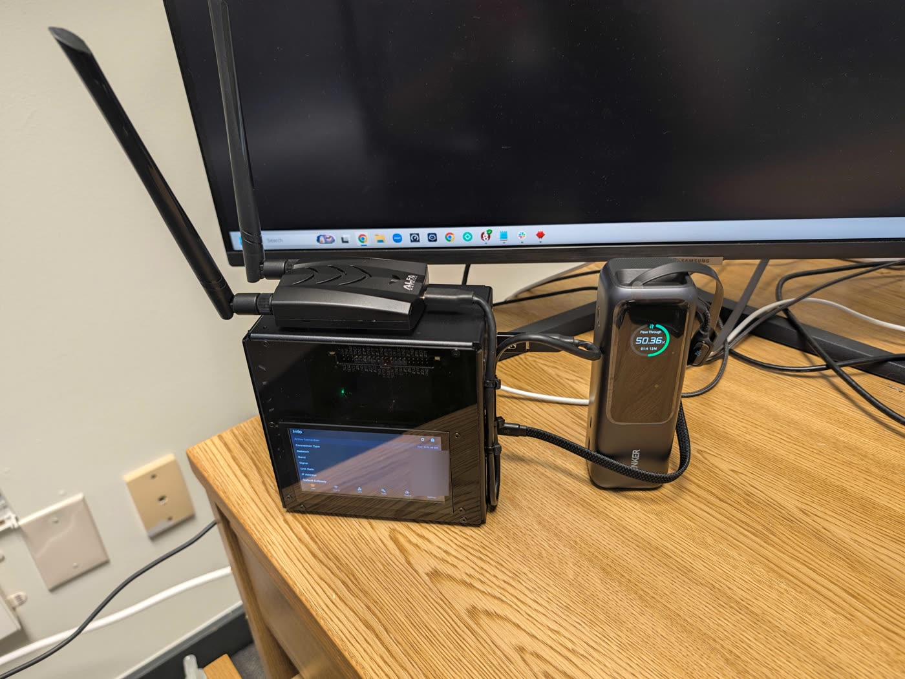
   The real thing: Raspberry Pi 5, touch-screen case, Wi-Fi 6E adapter, running from a battery pack.
  <a href="#hardware-used">Hardware used</a> · <a href="#the-tester-photos">more photos</a>

## On the touch screen

Every tool opens as its own full-screen page that updates live. Screenshots use a demo network with made-up data.

  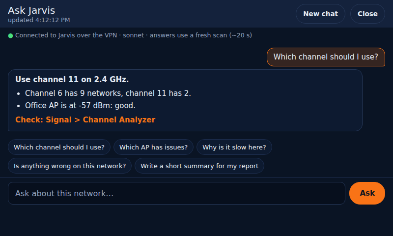
  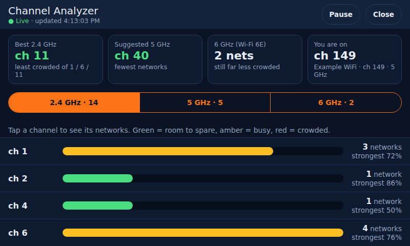

  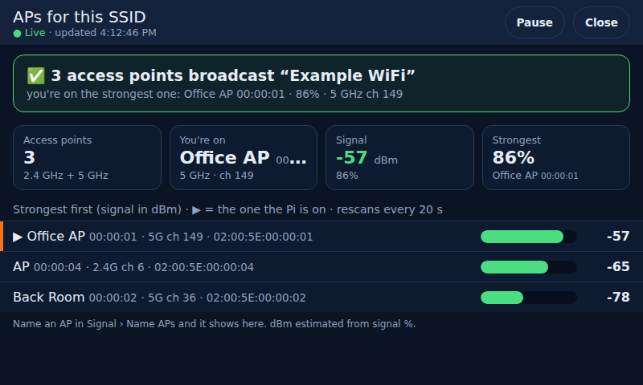
  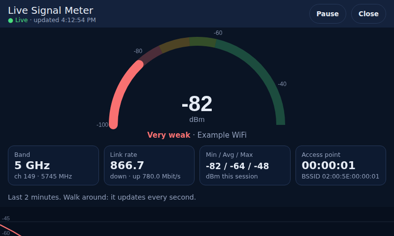

  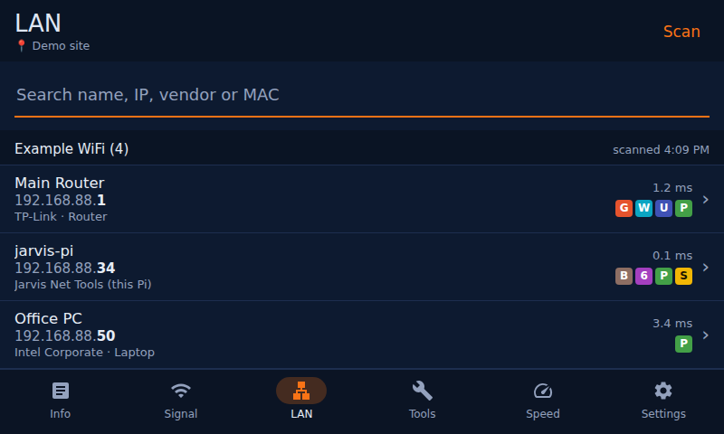
  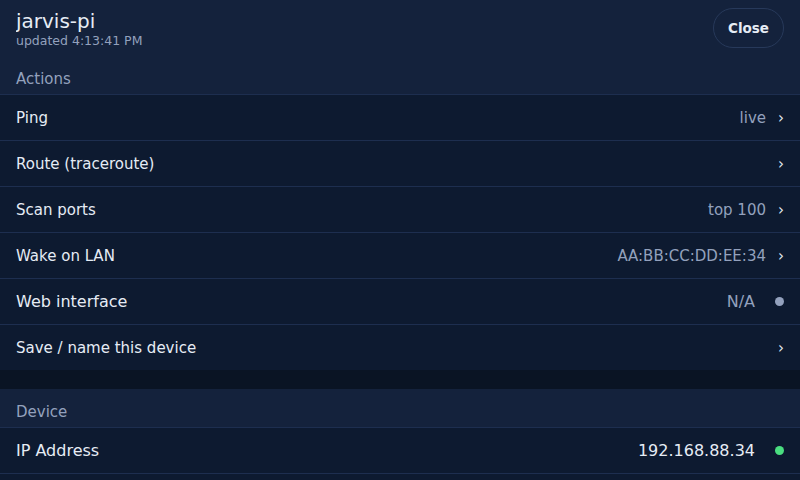

  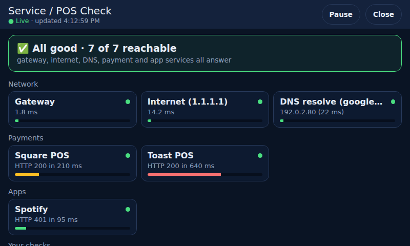
  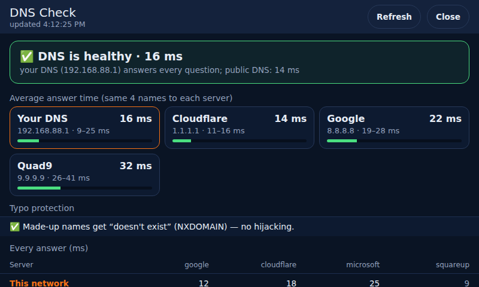

  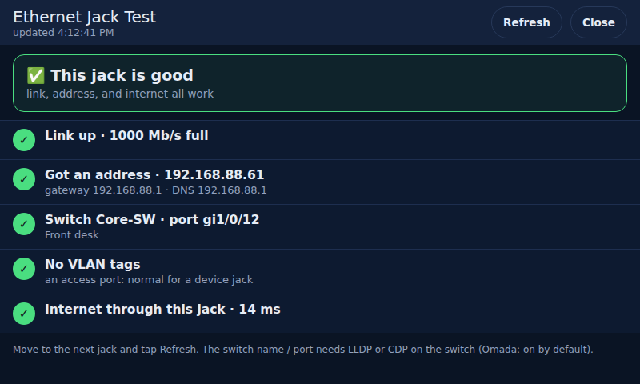
  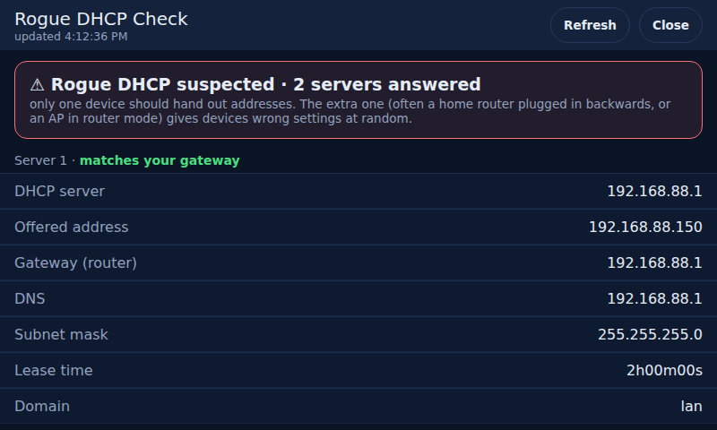

  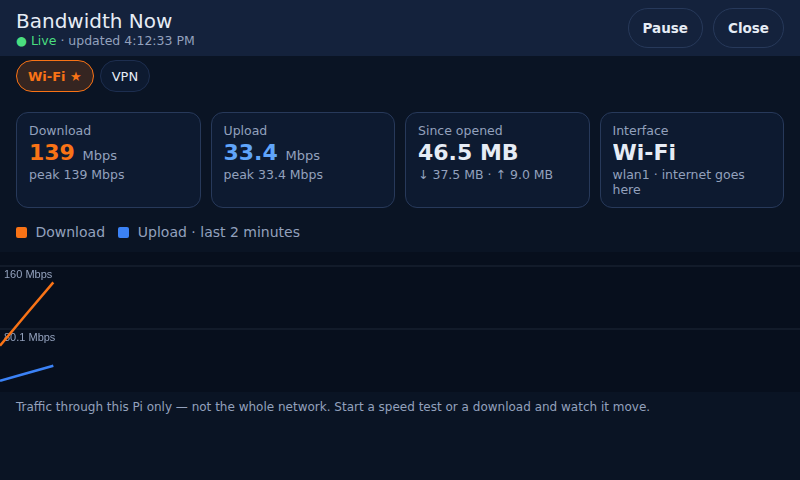
  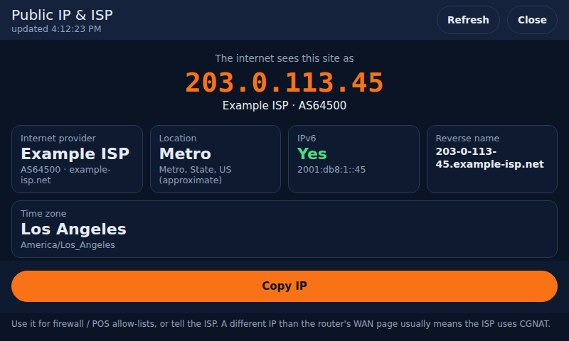

  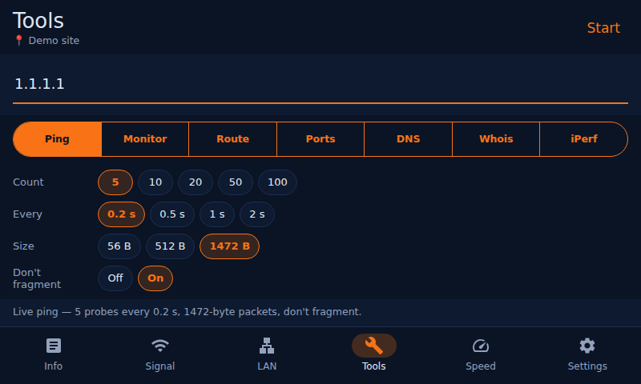
  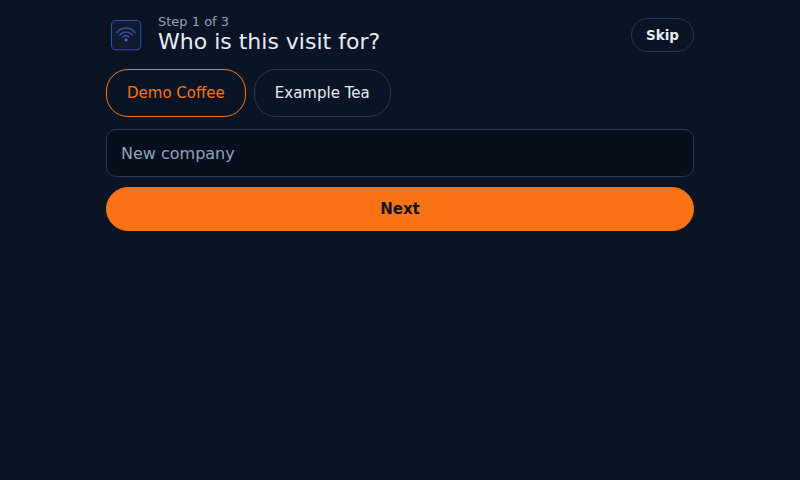

## On a phone

The same app on a phone, over the VPN:

  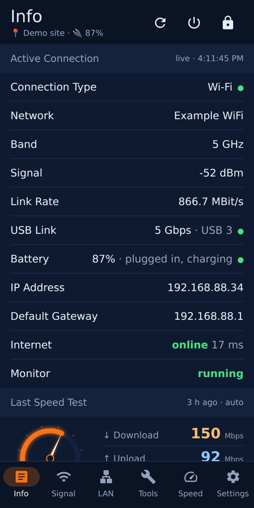
  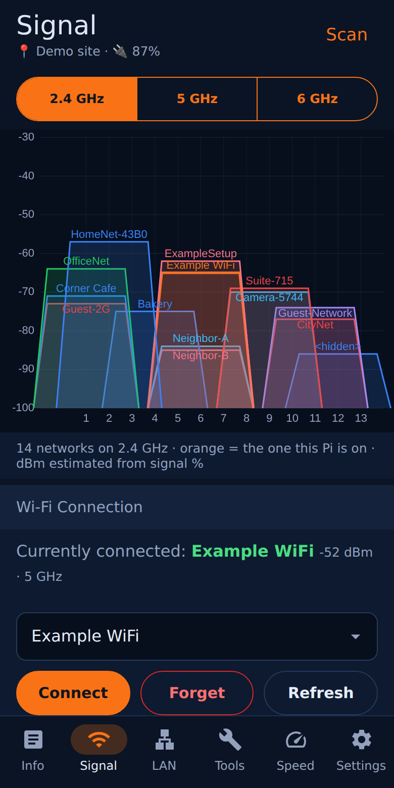
  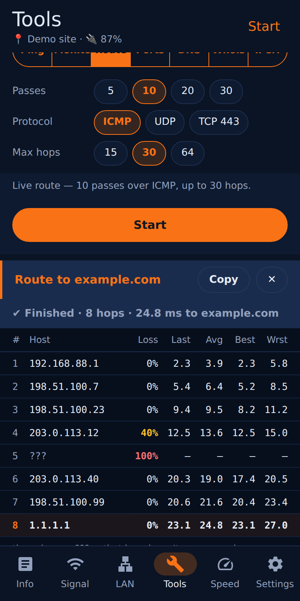
  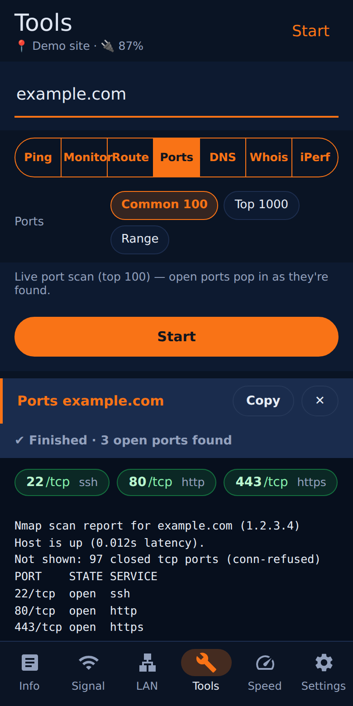

  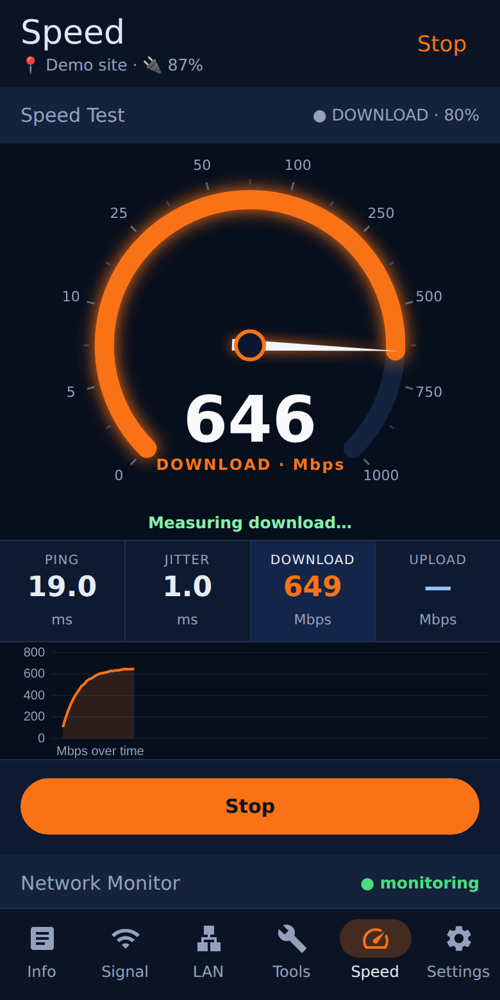
  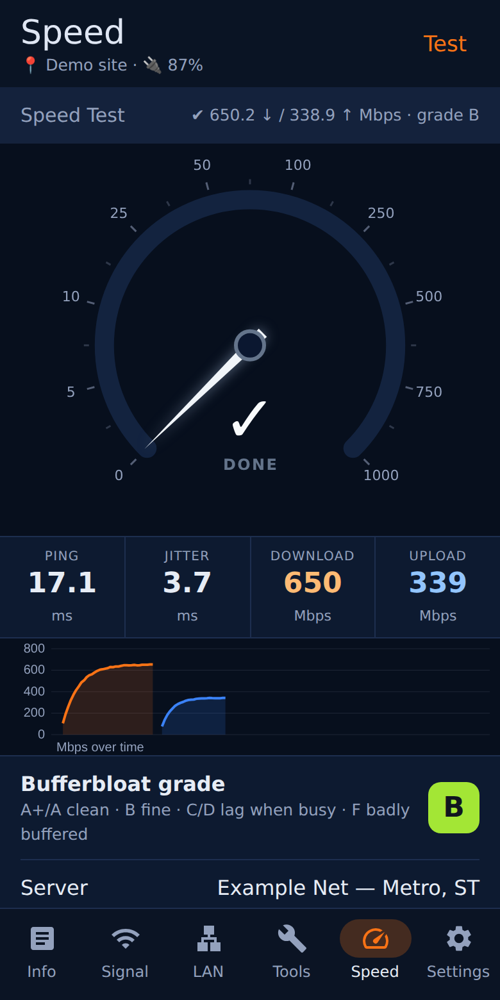
  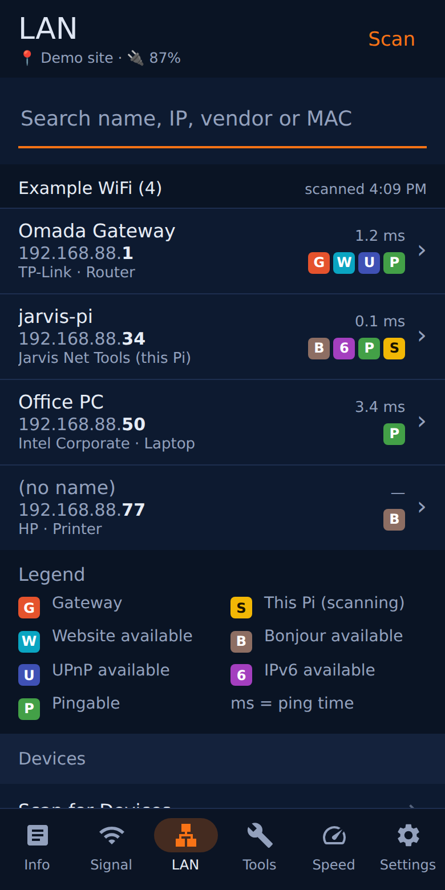

## What it does

| Tab | Highlights |
|---|---|
| **Info** | Connection, SSID, band, signal, link rate, IP and gateway; battery level; 24 h uptime and outages; last speed test; **Ask Jarvis**, **Service / POS Check**, **Live Signal Meter**; power button. |
| **Signal** | Live Wi-Fi **channel graph** (2.4 / 5 / 6 GHz) and join list; **Channel Analyzer** (crowding per channel, best channel); **APs for this SSID** (every access point, warns about sticky clients); **Watch Roaming**; pick a specific access point and band; show/hide password when joining. |
| **LAN** | Device list with badges (gateway, web page, UPnP, Bonjour, IPv6, answers ping, services) and a **Device Details** page; device watch; saved devices with Wake-on-LAN; **Rogue DHCP Check**; **Ethernet Jack Test** (waits for the cable, then link speed, address, switch and port, VLAN tags, internet). |
| **Tools** | **Ping** (count, interval, packet size, don't fragment), ping **monitor**, live **route** (ICMP / UDP / TCP 443, max hops), live **port scan** (common, top 1000 or a range), **DNS** (any record type, any server), **Whois** (domains and IP networks), iPerf3, **Open Ports**, **Bandwidth Now**. |
| **Speed** | A **speedometer** speed test with ping / jitter / download / upload, a **bufferbloat grade**, history charts, an outage timeline, **Public IP & ISP**, **DNS Check** (your DNS vs public DNS, typo-hijack test) and today's **History** with filter and search. |
| **Settings** | Site name, scheduled speed tests, setup hotspot Off / Auto / On, custom service checks, saved devices, Ask Jarvis on/off, email for reports, saved reports, password, safe shutdown. |

**For site visits:** a **setup wizard** on the first start of each day (company, location, Wi-Fi), a history that lasts one
day, **Finish Visit** (saves the site report and starts fresh next time), and **Share** for every report: save to a USB
stick, email it as a PDF, or download it. Wi-Fi passwords from visited sites are deleted every day.

**Ask Jarvis:** type a question or tap one ("Which channel should I use?", "Which AP has issues?", "Why is it slow here?").
The tester takes a fresh read-only scan and Jarvis answers in plain words with real numbers and where to look in the app.
It can only read the scan: it cannot change anything, and passwords never leave the tester.

## How it works (in plain words)

- **Live, not "wait and see".** Ping, route, port scans and the speed test stream their results to the screen as they
  happen, so you watch the hops and open ports appear.
- **Made for a small touch screen.** The Pi boots straight into the app on its 4.3" screen with an on-screen keyboard;
  the same app works on a phone over a VPN.
- **Safe by design.** One app password, login throttling, a tiny allow-list for the few things that need admin rights,
  strict browser security headers, and reachable only from the tester itself or a private VPN.
- **Tested without the hardware.** Hundreds of automated checks run every page against a simulated tester before
  anything is installed on the real one.

## Hardware notes

Developed on a Raspberry Pi 4, now a Raspberry Pi 5, with a USB 3 Wi-Fi 6E adapter as the main radio and the built-in radio
for a setup hotspot. Lessons that cost real time: the adapter must connect at USB 3 (at USB 2 it caps near 150 Mbit/s) and
some USB-C cables only reach USB 3 in one plug orientation; a Pi 5 needs a supply that offers 5 V / 5 A (on 3 A it slows
down under load); turn Wi-Fi power save off; and the Wi-Fi link rate is a raw rate: expect a fraction of it in practice.

### Hardware used

| Part | What | Notes |
|---|---|---|
| Computer | **Raspberry Pi 5 Model B, 8 GB** (CanaKit Raspberry Pi 5 Starter Kit PRO) | Raspberry Pi OS Lite 64-bit, boots from NVMe; the microSD card stays as a fallback |
| Case | **SunFounder Pironman 5 Pro Max** | 4.3" 800x480 touch screen (runs the app), small OLED status screen, tower cooler + 2 fans, power button, NVMe board |
| Storage | **Samsung 960 EVO 500 GB** NVMe SSD | boot disk |
| Wi-Fi (tests) | **ALFA Network AWUS036AXML** - Wi-Fi 6E, AXE3000, 2.4 / 5 / 6 GHz, USB 3.0 | MediaTek MT7921AU, driver built into Linux; up to 80 MHz channels on Linux, so the link tops out near 1.2 Gbit/s |
| Wi-Fi (setup hotspot) | the Pi's built-in radio | only on when needed |
| Power at the desk | **5.1 V / 5 A USB-C PD** supply (Pi 5 type) | a 5 V / 3 A source makes the Pi slow down under load |
| Power on the go | **Argon PWR UPS, 10,000 mAh** (5 V / 5 A USB-C out) | full speed on battery; the app shows the battery % and shuts down safely when it runs low |
| Cables | short **USB-A to USB-C 10 Gbps** cable for the adapter; **5 A (e-marked) USB-C** cable for power | some USB-C cables reach USB 3 in one plug orientation only |

Measured with this setup (business cable line, 5 GHz): **775 / 340 Mbps** on the 5 A supply, **734 / 354 Mbps** on the
battery; a Wi-Fi 7 laptop on the same access point did 682 / 342.

### The tester (photos)

Private network details in the photos are blurred.

  
  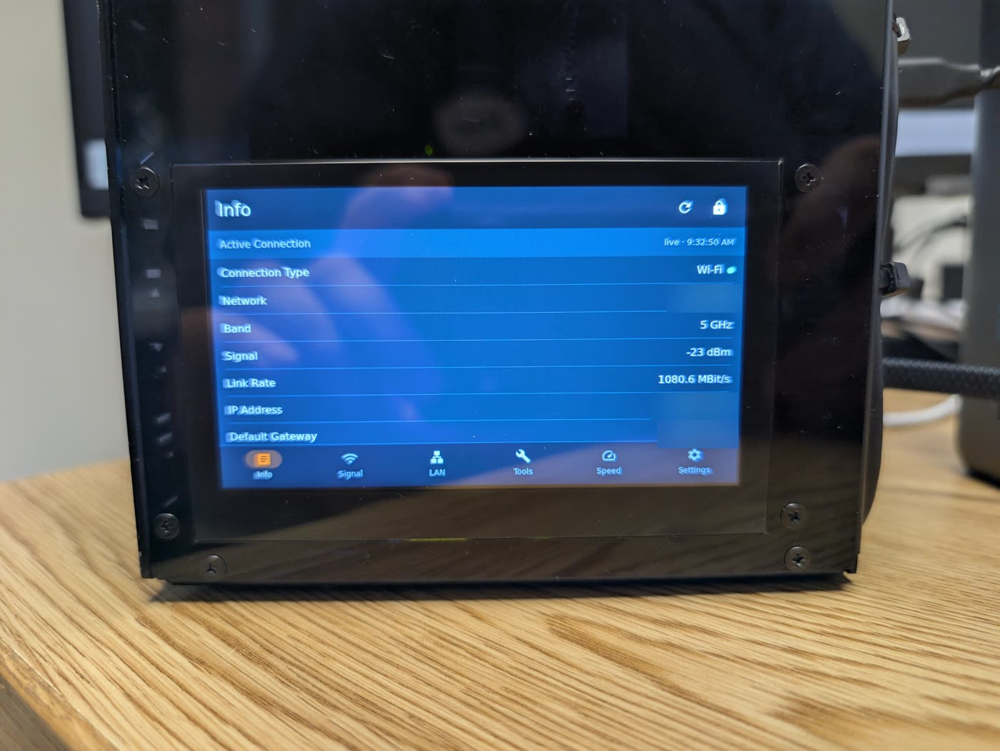
  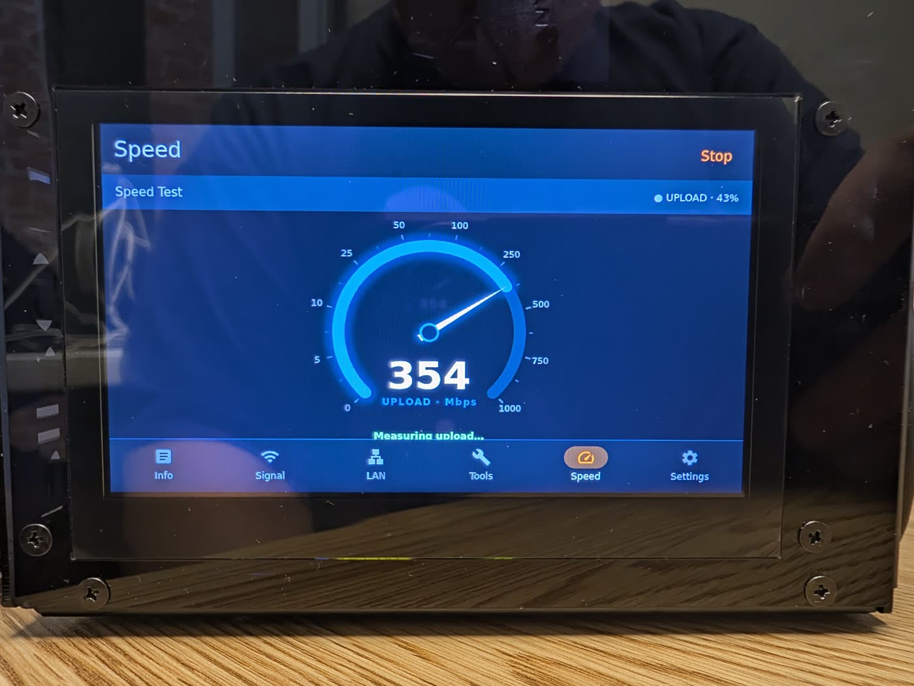

  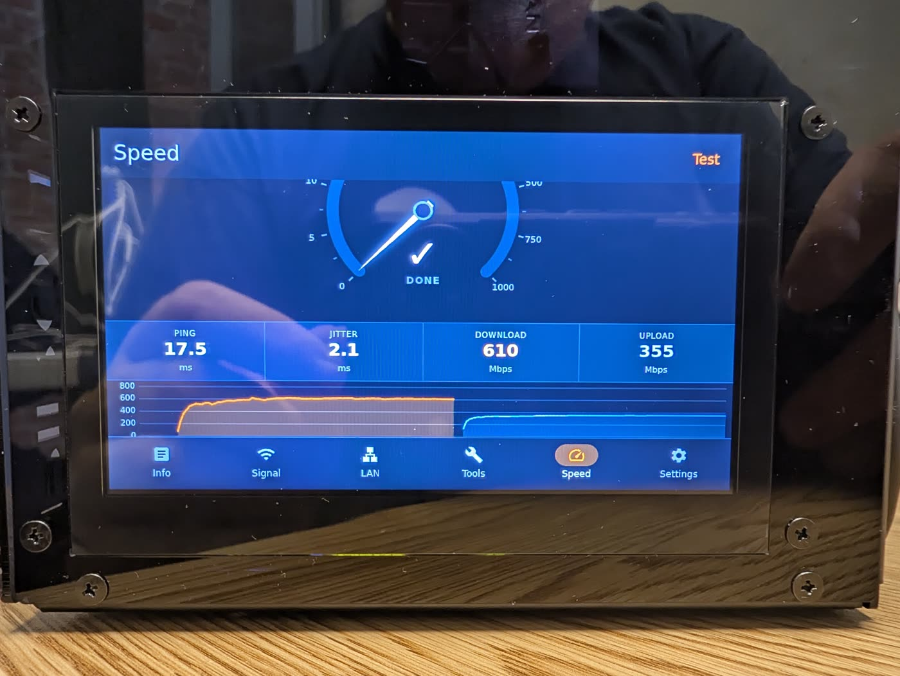
  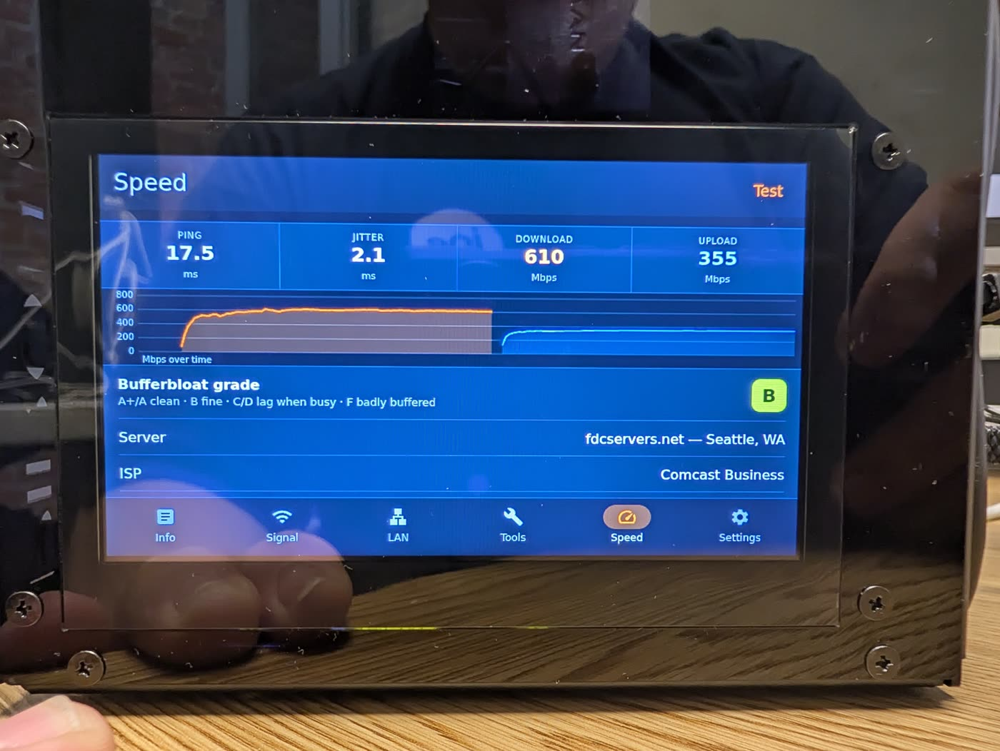
  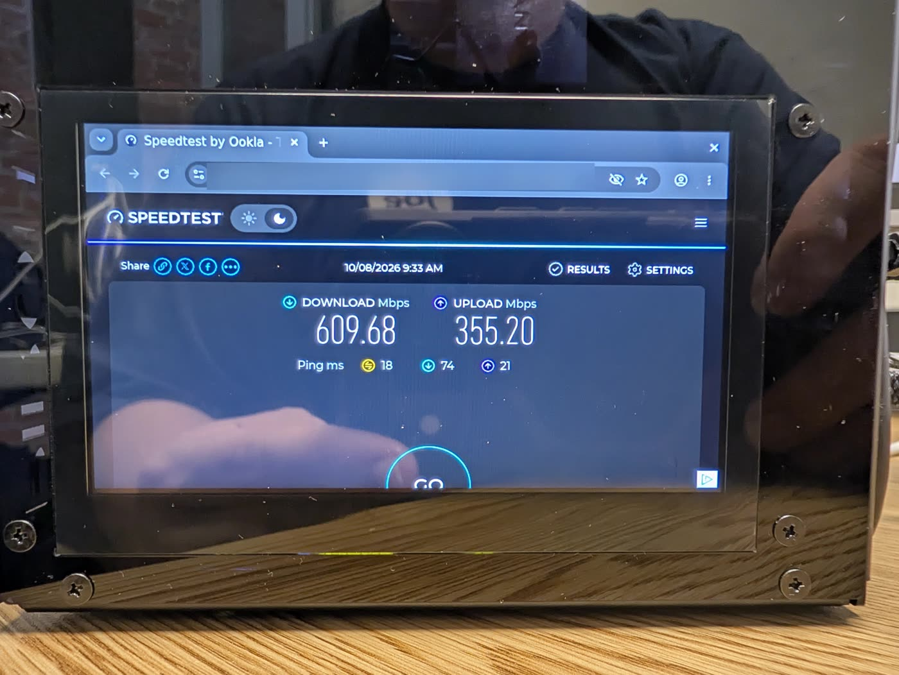

## License and credits

All rights reserved: see [`LICENSE`](LICENSE). The app's icons are Material Design icons by Google (Apache License 2.0).
Built by Richard Applegate (**X4Applegate**) together with his AI coding assistant, **Jarvis AI Agent**.
